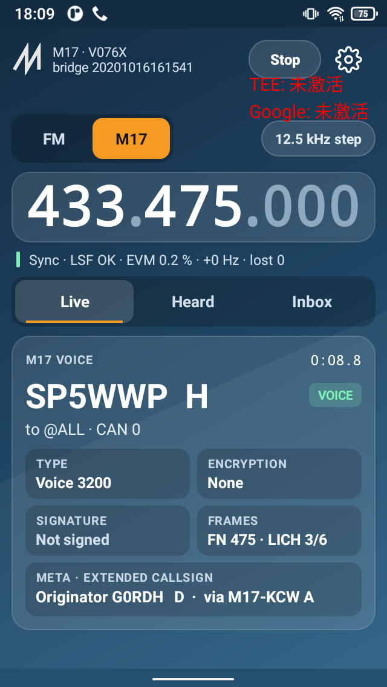

# AtoM17

FM and M17 receiver for the Unihertz Atom XL's built-in radio, and nothing else. Root (Magisk) required.

AtoM17 is **based on SignalDeck** (© 2026 IIMacGyverII, GPL-3.0-or-later, see `COPYRIGHT.SignalDeck`). It reuses
SignalDeck's bridge protocol, power sequences, V076J symbol-engine transmit path and firmware loader. Only the parts
FM and M17 need were taken, there is no DMR, no other mode and no network service. It is a modified work and not
SignalDeck.

## Main screen

Disregard the red overlay text, it is not rendered by the app.


## What it does

* **FM:** 400-480 MHz, squelch 0-9, CTCSS receive and transmit (51 tones), 12.5/25 kHz, low/high power.
* **PTT:** the side key, learned once (Device -> Learn PTT key) and read from the kernel input device as root
  (`getevent`), so it works with the screen off. An on-screen toggle can be turned on as a fallback.
* **M17 receive:**
  * voice, link info, and SMS
  * META: multi-block text, GNSS position, extended callsign data (ECD)
  * AES-128/192/256 and 8/16/24-bit scrambler decryption
  * ECDSA signature checks against stored public keys
* **M17 transmit** (needs a modified firmware in the module): Codec2 3200 voice, CAN, the same three META kinds (position from the
  phone's GNSS), AES or scrambler, signed streams (key generated on the phone), and SMS (packet mode). All of it goes
  through the V076J symbol engine.
* **Firmware:** loads V076J or restores the vendor V076 with SignalDeck's loader sequence. Both images are built on the
  phone from its own `/vendor/data/dmr/DMR006.U4A.V076.bin`. The APK carries only patches (`assets/*.patch.json`). The
  P1 loader bridge is built the same way from `/vendor/data/mcu/20201016161541.bin`.

Libraries: libm17 (`3684edc`), Codec2-mod `split-no-doubles` (`1e5d642`), micro-ecc (M17 fork), tinier-aes, libm17rx
from `m17_sdrsharp` (`10be6e8`). The TX encoder (`app/src/main/cpp/m17tx.c`) follows gr-m17's `m17_coder`.

## Build

```
export ANDROID_HOME=~/android-sdk     # platform 34, build-tools 34, NDK 26.3.11579264, CMake 3.22.1
./gradlew assembleDebug               # app/build/outputs/apk/debug/app-debug.apk
```
Host test of the M17 core:
```
C=app/src/main/cpp; T=$C/third_party
gcc -O2 -std=gnu11 -w -o loopback tools/hosttest/loopback.c $C/m17tx.c $C/m17rx/src/*.c $T/libm17/m17.c \
  $T/libm17/{decode,encode,math,payload,phy}/*.c $T/codec2-mod/src/*.c $T/micro-ecc/uECC.c $T/tinier-aes/aes.c \
  -I$C -I$C/m17rx/include -I$C/m17rx/src -I$T/libm17 -I$T/codec2-mod/inc -I$T/micro-ecc -I$T/tinier-aes -lm && ./loopback
```

## Install and first run

1. `adb install app-debug.apk`. Use **Wi-Fi adb**: while the radio is on, the phone's USB socket belongs to the radio
   bridge and a cable connection drops.
2. Open AtoM17, allow the microphone (and location, for GNSS META), then press **Start** and grant root in Magisk.
3. AtoM17 then:
   * stops and disables the stock intercom app (`com.agold.intercom`);
   * stops the radio HAL;
   * turns off Android's USB audio routing;
   * powers the bridge.

   **Stop** reverses all of this. The stock app is re-enabled only if the bridge last answered with its stock build.
4. If the App block dialog appears, turn off "background cleanup" for AtoM17, or the phone stops it a few minutes
   after the screen goes off.

## Licences

The app is GPL-3.0-or-later (`LICENSE`), with SignalDeck's additional terms (`COPYRIGHT.SignalDeck`) for the files
derived from it. Third-party licences are in each directory under `app/src/main/cpp/third_party/` and
`app/src/main/cpp/m17rx/` (GPL-2.0-or-later with the SDR# exception). See `docs/PROTOCOL.md` for the hardware
protocol.
