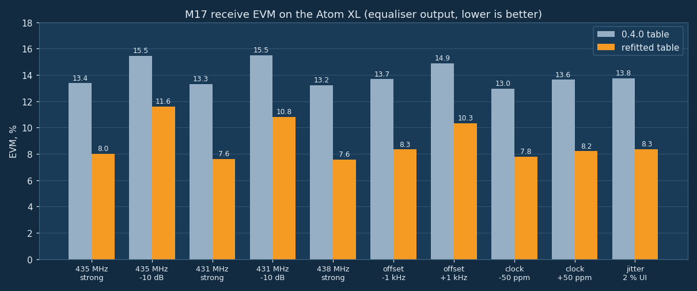
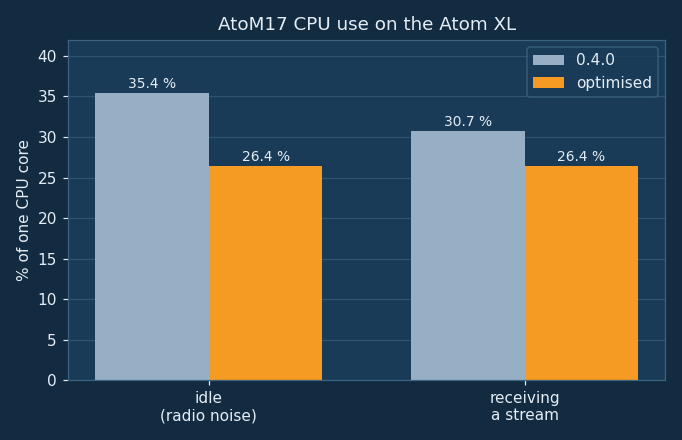

# M17 receive tuning on the bench (2026-11-17)

AtoM17 receives M17 through the Atom XL's radio audio, which has no low frequencies left. A decision-feedback
equaliser (`dfe/M17Receiver.java`, 93 coefficients from `assets/m17/eq_unihertz-atomxl.txt`) restores the symbols for
libm17rx. This report compares the equaliser table and the receiver's CPU use before and after a closed-loop session
with a USRP B210 as the reference transmitter.

## Method

- **Reference signal.** The B210 sent M17 streams generated by pyM17 0.2.0 (bit-exact with libm17): random payloads,
  ideal 4FSK at the nominal deviation (+-2.4 kHz for the outer symbols), cabled to the Atom XL through 30 dB of
  attenuation. The B210 was tuned 200 kHz below the channel so its LO leakage stayed out of it.
- **Recording.** AtoM17's Diagnostics recording keeps exactly what the equaliser gets (8 kHz). Every burst was found
  in the recording by correlation with its known symbols.
- **Fit.** The table was fitted on one ideal 6 s burst only, as the specification defines the signal. Impaired
  signals and real radios were not used for the fit: a handful of individual transmitters would only skew it.
- **Evaluation.** The same Java equaliser as in the app ran on the PC over each recording, with the old and the new
  table. It reproduces the app's own results (frames decoded and confirmed). EVM is the RMS decision error relative
  to the RMS symbol level (sqrt 5), as the Diagnostics page shows it, here averaged over all confirmed frames.
- **Robustness.** Bursts with a carrier offset (+-1 kHz), a symbol clock error (+-50 ppm), slow timing jitter (2 % of
  a symbol RMS) and Rayleigh fading, at 431, 435 and 438 MHz, at a strong level and 10 dB lower. None of these went
  into the fit.

## Results

| Signal | EVM, 0.4.0 table | EVM, refitted | Symbol errors before FEC, 0.4.0 / refitted |
|---|---|---|---|
| 435 MHz, strong (burst not used for the fit) | 13.4 % | **8.0 %** | 0.20 % / **0 %** |
| 435 MHz, 10 dB lower | 15.5 % | **11.6 %** | 0.54 % / **0.18 %** |
| 431 MHz, strong | 13.3 % | **7.6 %** | 0.19 % / **0 %** |
| 431 MHz, 10 dB lower | 15.5 % | **10.8 %** | 0.94 % / **0.01 %** |
| 438 MHz, strong | 13.2 % | **7.6 %** | 0.23 % / **0 %** |
| Carrier offset -1 kHz | 13.7 % | **8.3 %** | 0.35 % / **0 %** |
| Carrier offset +1 kHz | 14.9 % | **10.3 %** | 0.44 % / **0 %** |
| Symbol clock -50 ppm | 13.0 % | **7.8 %** | 0.29 % / **0 %** |
| Symbol clock +50 ppm | 13.6 % | **8.2 %** | 0.33 % / **0.01 %** |
| Timing jitter 2 % | 13.8 % | **8.4 %** | 0.21 % / **0 %** |

- The best this equaliser structure can do on the strong burst, fitted with the true symbols, is 7.5 %. The refitted
  table is within 0.1 to 0.5 points of that limit, the old one about 5 points away.
- The decode limit did not move: both tables stop decoding about 4 dB below the "10 dB lower" level. That is the FM
  threshold of the radio, where the noise grows faster than an equaliser can follow. Close to it the refitted table
  still makes about half the symbol errors.
- Under Rayleigh fading neither table decoded at the levels tested: the fades take the signal below the FM threshold,
  which no equaliser recovers.
- A second fit on a different burst gave other coefficients (40 % apart) with the same performance: the fit is not
  sensitive to the recording it was made on.
- The equaliser tracks the Atom XL's recording clock, measured at +110 ppm against the B210.

## CPU

AtoM17's process on the phone, measured from `/proc` over 16 to 20 s on the main screen:

| | 0.4.0 | now |
|---|---|---|
| Idle, radio noise | 35.4 % of a core | **26.4 %** |
| Receiving a stream | 30.7 % | **26.4 %** |

Most of the idle work was the search for calls joined late, which equalises and decodes candidate frames in the
noise. The changes (`simpleperf` on the phone and a Java profile on the PC showed where):

- Late-entry candidates stop after a quarter frame when their decision error is far above a real frame's, and only
  frames below a set error go to the Viterbi decoder. Real late entries stay below 0.85, noise sits near 11.
- The 48 kHz buffer is indexed by a mask, not a division, the interpolator uses per-phase taps, and the equaliser
  reads its taps directly and shifts its history in a loop (`System.arraycopy` is a call on ART).
- libm17rx gets frames of silence only for 2 s after a call, not all the time.

On 17 recordings (streams, packets, late entries, weak signals and a minute of noise) the optimised equaliser gives
results identical to 0.4.0's.

## Not measured

The transmit direction (the Atom XL's own EVM, spectrum at key-up and key-down, preamble and EoT in stream and packet
mode) needs more attenuation in front of the B210 than this bench had, and is left for a later session.
